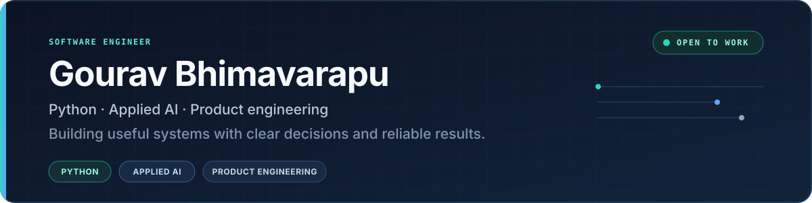

  

  
  
  

## About me

I'm a software engineer and M.S. Computer Science student at Arizona State University. **Python is my strongest language.** I use it to build applied AI systems, automation, and reliable backend workflows. I also build complete web products with TypeScript and React.

I enjoy turning a clear problem into a simple product that people can use. My current work focuses on practical AI, education tools, and thoughtful consumer software.

I'm seeking full-time **Software Engineer** and **AI Engineer** roles.

## Selected work

### [Mise](https://github.com/Gourav-praneeth/mise-kitchen)

**React · TypeScript · Vite · Local-first product design**

A kitchen-first food management app that helps people use what they already have. Mise tracks freshness, highlights food that should be used soon, matches recipes to available ingredients, adjusts quantities by serving size, and connects cooking with a live grocery list.

[Live demo →](https://misekitchen-ten.vercel.app/) · [Source code →](https://github.com/Gourav-praneeth/mise-kitchen)

I used **Codex** throughout development to move quickly from product idea to a responsive working MVP.

### [GradeLens](https://github.com/Gourav-praneeth/GradeLens)

**Next.js · TypeScript · Prisma · SQLite · Docker · Vitest**

A human-in-the-loop autograder for instructors and teaching assistants. GradeLens creates editable rubrics from official solutions, evaluates PDF or text submissions, explains every deduction, supports Canvas workflows, and exports grades for review.

[Source code →](https://github.com/Gourav-praneeth/GradeLens)

The application supports OpenAI, Anthropic, and Groq models, persistent deployment, instructor accounts, course rosters, and team workflows. I developed it with **Cursor** and **Claude Code**.

### [AutoResearch](https://github.com/Gourav-praneeth/autoresearch)

**Python · Pydantic · Streamlit · OpenAI API · Multi-agent systems**

A five-agent research pipeline that turns a question into a structured report. Separate agents plan the work, retrieve sources, extract facts, review gaps, and write the final result. Typed schemas, confidence scores, a bounded review loop, and downloadable traces keep each run clear and inspectable.

[Live demo →](https://multi-agent-autoresearch.streamlit.app/) · [Source code →](https://github.com/Gourav-praneeth/autoresearch)

I developed AutoResearch with **Cursor** and **Claude Code**, using Python to design the agent workflow and orchestration.

## Skills

- **Primary language:** Python
- **Languages:** Python, TypeScript, JavaScript, SQL, Java, C++
- **Applied AI:** LLM applications, multi-agent workflows, structured outputs, retrieval, evaluation, prompt design
- **Frameworks:** React, Next.js, Streamlit, Vite, Pydantic, Prisma
- **Data and delivery:** SQLite, REST APIs, Docker, GitHub Actions, Vercel, Railway
- **Testing:** pytest, Vitest, ESLint
- **AI-assisted development:** Codex, Cursor, Claude Code

## Beyond engineering

- Mentored **700+ students** in Python, C++, and mathematics across five teaching roles.
- Founded and grew ASU's Board Games Club to **280+ members**.
- Built accessible and human-centered projects, including a tactile campus map for visually impaired students.

---

  <strong>Build useful software. Test it well. Keep improving.</strong> 
  Open to full-time opportunities and thoughtful collaborations.

