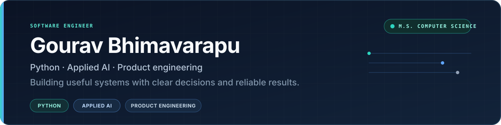

  

  
  
  

## About me

I'm a software engineer who builds applied AI systems and complete web products. **Python is my strongest language**, and I use it for agent workflows, automation, and backend engineering. I also work with TypeScript, React, and Next.js.

I earned my **M.S. in Computer Science from Arizona State University in May 2026** and completed my **bachelor's degree in 2025**.

I care about clear product decisions, reliable systems, and software that solves a real problem.

## Selected work

### [AutoResearch](https://github.com/Gourav-praneeth/autoresearch)

**Python · Pydantic · Streamlit · OpenAI API · Multi-agent systems**

A five-agent research pipeline that turns a question into a structured report. Separate agents plan the work, retrieve sources, extract facts, review gaps, and write the result. Typed schemas, confidence signals, a bounded review loop, and downloadable traces make each run easier to inspect.

[Live demo →](https://multi-agent-autoresearch.streamlit.app/) · [Source code →](https://github.com/Gourav-praneeth/autoresearch)

I developed AutoResearch with **Cursor** and **Claude Code**, using Python to design the agent workflow and orchestration.

### [GradeLens](https://github.com/Gourav-praneeth/GradeLens)

**Next.js · TypeScript · Prisma · PostgreSQL · Neon · Docker**

A human-in-the-loop autograder for instructors and teaching assistants. GradeLens creates editable rubrics from official solutions, evaluates PDF or text submissions, explains every deduction, supports Canvas workflows, and exports grades for review.

[Live demo →](https://gradelens-j97n.onrender.com/) · [Source code →](https://github.com/Gourav-praneeth/GradeLens)

The application supports OpenAI, Anthropic, and Groq models, persistent deployment, instructor accounts, course rosters, and team workflows. It uses Neon PostgreSQL and S3-compatible object storage and is deployed on Render. I developed it with **Cursor** and **Claude Code**.

### [Mise](https://github.com/Gourav-praneeth/misekitchen)

**React · TypeScript · Vite · Supabase · PostgreSQL**

A shared kitchen companion for inventory, meal planning, recipe matching, and grocery coordination. Mise supports shared households, real-time grocery updates, barcode scanning, receipt OCR, and offline recovery so daily kitchen work stays organized.

[Live demo →](https://misekitchen-ten.vercel.app/) · [Source code →](https://github.com/Gourav-praneeth/misekitchen)

I used **Codex** throughout development while retaining responsibility for the product, architecture, and quality decisions.

## Skills

- **Primary language:** Python
- **Languages:** Python, TypeScript, JavaScript, SQL, Java, C++
- **Applied AI:** LLM applications, multi-agent workflows, structured outputs, retrieval, evaluation
- **Frameworks:** Next.js, React, Streamlit, Vite, Pydantic, Prisma
- **Data and delivery:** PostgreSQL, Supabase, Neon, REST APIs, S3-compatible object storage, Docker, Vercel, Render
- **Quality:** Vitest, ESLint
- **AI-assisted development:** Codex, Cursor, Claude Code

## Beyond engineering

- Mentored **700+ students** in Python, C++, and mathematics across five teaching roles.
- Founded and grew ASU's Board Games Club to **280+ members**.
- Built accessible and human-centered projects, including a tactile campus map for visually impaired students.

---

  <strong>Build useful software. Test it well. Keep improving.</strong> 
  Have a software, AI, or product idea? <a href="mailto:gouravprb610@gmail.com">Let's talk.</a>

