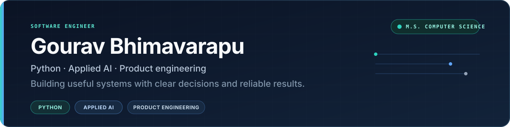

  

  
  
  

## About me

I'm a software engineer who builds practical AI systems and end-to-end web products. I work primarily with Python, combining agentic workflows, LLM APIs, backend development, and modern web technologies to turn complex ideas into reliable tools. I'm driven by thoughtful product decisions, strong engineering practices, and building software that creates measurable value.

I earned my **M.S. in Computer Science from Arizona State University in May 2026** and completed my bachelor's degree in 2025.

## Selected work

### [AutoResearch](https://github.com/Gourav-praneeth/autoresearch)

**Python · Pydantic · Streamlit · OpenAI API · Multi-agent systems**

A five-agent research pipeline that turns a question into a structured report. Separate agents plan the work, retrieve sources, extract facts, review gaps, and write the result. Typed schemas, confidence-aware outputs, and a review step help keep each report focused and traceable.

[Live demo →](https://multi-agent-autoresearch.streamlit.app/) · [Source code →](https://github.com/Gourav-praneeth/autoresearch)

I developed AutoResearch with **Cursor** and **Claude Code**, using Python to design the agent workflow and orchestration.

### [GradeLens](https://github.com/Gourav-praneeth/GradeLens)

**Next.js · TypeScript · Prisma · PostgreSQL · Neon · Docker**

A human-in-the-loop autograder for instructors and teaching assistants. GradeLens creates editable rubrics from official solutions, evaluates PDF or text submissions, explains every deduction, supports resubmissions, and keeps instructors in control of the final grade.

[Live demo →](https://gradelens-j97n.onrender.com/) · [Source code →](https://github.com/Gourav-praneeth/GradeLens)

The application supports OpenAI, Anthropic, and Groq models, persistent deployment, instructor accounts, course rosters, and team workflows. It uses Neon PostgreSQL and S3-compatible object storage and includes Docker-based delivery.

### [Mise](https://github.com/Gourav-praneeth/misekitchen)

**React · TypeScript · Vite · Supabase · PostgreSQL**

A shared kitchen companion for inventory, meal planning, recipe matching, and grocery coordination. Mise supports shared households, real-time grocery updates, barcode scanning, receipt OCR, and offline-friendly workflows.

[Live demo →](https://misekitchen-ten.vercel.app/) · [Source code →](https://github.com/Gourav-praneeth/misekitchen)

I used **Codex** throughout development while retaining responsibility for the product, architecture, and quality decisions.

## Skills

- **Languages:** Python, TypeScript, JavaScript, SQL, Java, C++
- **AI and machine learning:** LLM application development, prompt engineering, multi-agent workflows, RAG, embeddings, structured outputs, AI evaluation
- **Backend:** FastAPI, REST APIs, Pydantic, authentication, server-side application logic
- **Frontend:** React, Next.js, Streamlit, Vite
- **Databases and storage:** PostgreSQL, Supabase, Neon, Prisma, S3-compatible object storage
- **DevOps and cloud:** Docker, GitHub Actions, CI/CD, Vercel, Render
- **Testing and tooling:** Vitest, pytest, ESLint, Git, Linux
- **AI-assisted development:** Codex, Cursor, Claude Code

## Beyond engineering

- Mentored **700+ students** in Python, C++, and mathematics across five teaching roles.
- Founded and grew ASU's Board Games Club to **280+ members**.
- Built accessible and human-centered projects, including a tactile campus map for visually impaired students.

---

  <strong>Build useful software. Test it well. Keep improving.</strong> 
  Have a software, AI, or product idea? <a href="mailto:gouravprb610@gmail.com">Let's talk.</a>

